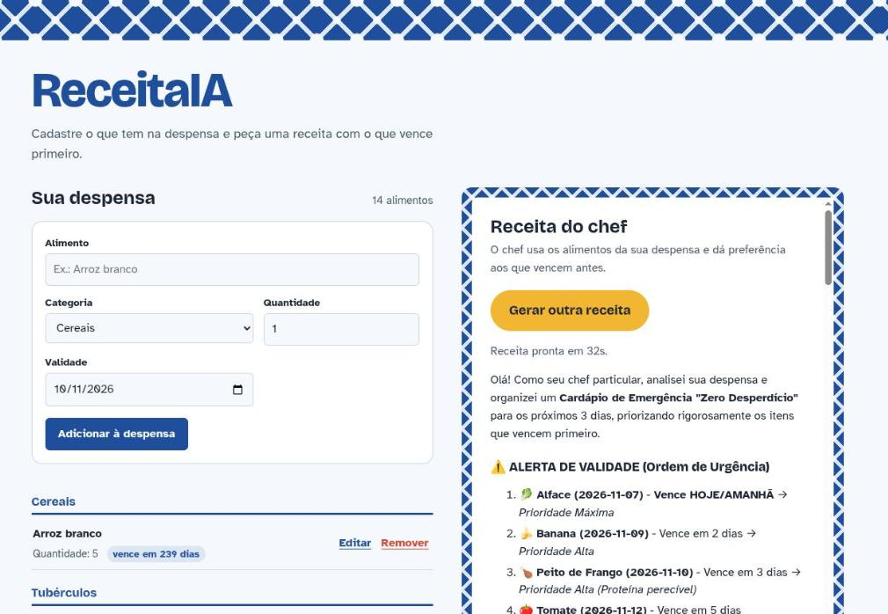

# ReceitaIa

Aplicação para guardar o que tem na despensa (nome, categoria, quantidade e validade) e pedir a uma IA
uma receita feita com esses alimentos, dando preferência aos que vencem antes.



## O que dá para fazer

- Cadastrar, editar e remover alimentos pela tela ou pela API REST
- Ver a despensa agrupada por categoria, com a validade em dias e destaque para o que vence em até 7 dias
- Gerar uma receita com IA a partir de tudo o que está no banco

## Stack

- Java 21 e Spring Boot 4.1.1 (Maven, wrapper incluído)
- Spring Web MVC para a API e Spring WebFlux (`WebClient`) para chamar a IA
- Spring Data JPA com Hibernate
- Flyway para as migrations do banco
- H2 gravado em arquivo no ambiente de desenvolvimento
- OpenRouter como provedor de LLM (modelo gratuito por padrão)
- Frontend em HTML, CSS e JavaScript puros, servido pelo próprio Spring
- Lombok

## Como rodar

1. Crie a chave da IA. Copie o arquivo de exemplo e coloque sua chave da
   [OpenRouter](https://openrouter.ai/settings/keys):

   ```bash
   cp .env.openrouter.example .env.openrouter
   # edite .env.openrouter e preencha OPENROUTER_API_KEY
   ```

   O `.env.openrouter` está no `.gitignore` e nunca vai para o repositório.

2. Suba a aplicação, dentro da pasta do projeto:

   ```bash
   ./mvnw spring-boot:run
   ```

3. Abra `http://localhost:8080`.

Para ter dados de teste, rode a collection do Postman com 14 alimentos de exemplo:

```bash
postman collection run postman/ReceitaIa-seed-comidas.postman_collection.json
```

Ou importe o arquivo no app do Postman e use **Run collection**.

Para rodar os testes:

```bash
./mvnw test
```

## Endpoints

| Método | Rota | O que faz | Resposta |
| --- | --- | --- | --- |
| `POST` | `/food` | cadastra um item | `201` com mensagem de confirmação |
| `GET` | `/food` | lista todos os itens | `200` com a lista |
| `GET` | `/food/{id}` | busca um item pelo id | `200` ou `404` |
| `PUT` | `/food/{id}` | atualiza um item | `200` ou `404` |
| `DELETE` | `/food/{id}` | remove um item | `204` |
| `GET` | `/generate` | gera uma receita com os itens da despensa | `200` com a receita em markdown |

Exemplo de cadastro:

```bash
curl -X POST http://localhost:8080/food \
  -H 'Content-Type: application/json' \
  -d '{"nome":"Arroz","categoria":"CEREAIS","quantidade":3,"validade":"2027-04-27"}'
```

A categoria vem do enum `Categoria` (cereais, tubérculos, leguminosas, verduras, legumes, frutas,
proteínas, gorduras, doces, bebidas e temperos) e é gravada no banco como texto.

## Como a receita é gerada

1. O `RecipeController` busca todos os alimentos pelo `FoodItemService`.
2. O `OpenrouterService` transforma cada item numa linha de texto
   (`Arroz branco (CEREAIS) - Quantidade: 5, Validade: 2027-06-30`) e monta o prompt.
3. O `WebClient` envia o prompt para `https://openrouter.ai/api/v1/chat/completions` com a chave no
   header `Authorization: Bearer ...`.
4. A resposta chega como JSON. O serviço lê `choices[0].message.content` e devolve o texto num `Mono<String>`.

O modelo padrão é o `openrouter/free`, um roteador da OpenRouter que escolhe a cada chamada um modelo
gratuito disponível. Para usar um modelo fixo, troque `OPENROUTER_MODEL` no `.env.openrouter`.

Como o endpoint devolve um `Mono`, o Spring MVC trata a requisição de forma assíncrona. Uma receita
completa pode levar mais de 30 segundos, então o limite de espera foi aumentado para 120 segundos em
`spring.mvc.async.request-timeout`.

## Banco de dados

O H2 grava em `data/receitaia.mv.db`, então os alimentos continuam lá depois de reiniciar a aplicação.
A pasta `data/` fica fora do git. Para começar do zero, pare a aplicação e apague essa pasta.

Console do H2, útil para olhar as tabelas enquanto a aplicação está de pé: `http://localhost:8080/h2-console`,
com JDBC URL `jdbc:h2:file:./data/receitaia;AUTO_SERVER=TRUE`, usuário `sa` e senha em branco.

O schema é criado pelas migrations do Flyway, em `src/main/resources/db/migration`. O Hibernate roda com
`spring.jpa.hibernate.ddl-auto=validate`: ele apenas confere se as entidades batem com as tabelas e falha
na inicialização quando algo diverge, em vez de alterar a estrutura por conta própria. Migração nova
entra como arquivo novo (`V3__descricao.sql`) e uma migration que já rodou não deve ser editada, porque o
Flyway guarda o checksum dela.

## Estrutura

```
src/main/java/Desplanchescom/example/ReceitaIa/
├── config/       WebClienteConfig      WebClient apontando para a OpenRouter
├── controller/   FoodItemController    rotas /food
│                 RecipeController      rota /generate
├── service/      FoodItemService       regras de negócio da despensa
│                 OpenrouterService     prompt e chamada à IA
├── repository/   FoodItemRepository    acesso ao banco
├── Mapper/       FoodItemMapper        conversão entidade <-> DTO
├── DTO/          FoodItemDTO           dados que entram e saem da API
├── model/        FoodItemModel         entidade JPA
└── enums/        Categoria             categoria de alimento
src/main/resources/
├── application.properties
├── db/migration/   migrations do Flyway
└── static/         frontend (index.html, css/, js/)
postman/            collection com alimentos de exemplo
```

## Dados sensíveis

A chave da OpenRouter fica no `.env.openrouter`, carregado pelo `spring.config.import` e fora do git. O
`.gitignore` também cobre `.env`, arquivos de chave (`*.pem`, `*.key`, `*.p12`, `*.jks`, `*.keystore`),
configuração local (`application-local.properties`) e de segredo (`application-secret*.properties`), o
banco H2 local e logs. Credencial de produção deve chegar por variável de ambiente, não por arquivo
versionado.

## Próximos passos

- Tratar erros da IA com `onStatus` e devolver uma mensagem amigável em vez do stack trace
- Trocar o `Map` da resposta por `record`s que espelham o JSON da OpenRouter
- Testes com JUnit 5 e Mockito para o `OpenrouterService`
